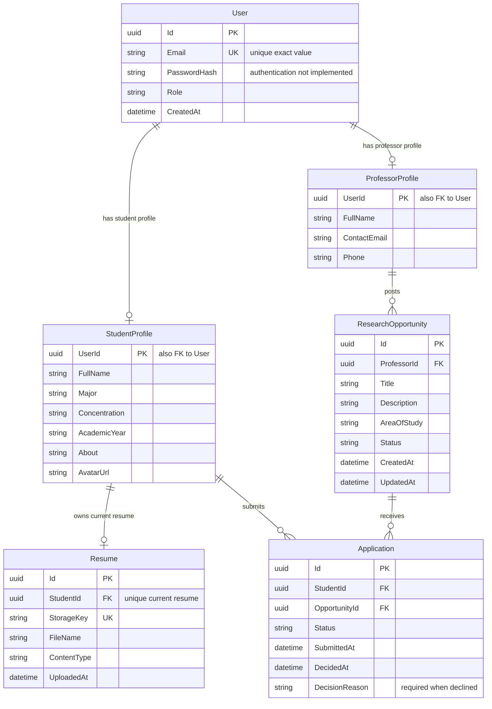

# Historical Data Architecture Assessment

> This assessment snapshot predates the merge with `main`; its entity inventory
> and Mermaid diagram are not the current schema. The authoritative model and
> constraints are documented in [docs/DATABASE.md](../../../../../docs/DATABASE.md)
> and [docs/uml/shared-data-class.puml](../../../../../docs/uml/shared-data-class.puml).
> The professor applicant-review page remains a sample-data UI, not an
> authenticated application API.

The application now has a PostgreSQL persistence foundation with six relational entities and Prisma Client 7. The React client has no direct database access; authentication and an API boundary are still required before the application service can be exposed.

## Database Configuration

| Service/Module | DB Type | Profile | Driver | Connection | Migration Tool |
|---|---|---|---|---|---|
| Local development | PostgreSQL | Developer-local | Prisma PostgreSQL adapter (`pg`) | `DATABASE_URL` from an ignored `.env`; Compose publishes port 5432 | Prisma Migrate; checked-in SQL migrations |
| Shared/production | Not configured | Not configured | Not configured | Not configured | Apply reviewed migrations only after deployment decisions and approval |

Prisma Migrate owns schema changes. The Compose database persists local data in a named volume. No production database was configured, contacted, or modified. See [README.md](../../../../../README.md) for per-developer setup.

## Data Ownership per Service

| Service | Tables Owned | ORM Framework | Caching | Notes |
|---|---|---|---|---|
| Persistence module (`src/data/`) | User, StudentProfile, ProfessorProfile, FileAsset, Opportunity, ResearchArea, OpportunityResearchArea, Application, Conversation, Message | Prisma Client 7 | None | Server-side access operations require trusted identity; applicant demo is not wired to an API |

## Entity Model

Entities are defined in [schema.prisma](../../../../../prisma/schema.prisma). Server-side application and decision operations are in [src/data/index.ts](../../../../../src/data/index.ts), with shared input validation in [src/data/validation.ts](../../../../../src/data/validation.ts). The professor applicant-review page remains a sample-data UI and is not connected to an authenticated application API.

<!-- mermaid-checked: every attribute is `<type> <name> [<key>] ["<description>"]` with at most one of PK/FK/UK, no \n in descriptions, no {} in descriptions, every relationship label is double-quoted -->

The database enforces one application per student/opportunity, foreign-key ownership, one current resume per student, and a non-empty decision reason for declined applications. Role/profile consistency and normalized-email comparison must be enforced by the future account-provisioning service.

## Key Repository Methods

| Service | Repository | Notable Methods | Purpose |
|---|---|---|---|
| Persistence module | `createDataAccess(db)` ([source](../../../../../src/data/index.ts)) | `listApplicants`, `decideApplication` | List applicants for a professor-owned opportunity and record accept/decline decisions with denial reasons |

Prisma model delegates provide standard create/read/update/delete operations for other models; no additional repository methods or raw SQL queries are exposed. The application repository relies on PostgreSQL's unique constraint to handle concurrent duplicate submissions safely.

## Caching Strategy

No cache provider, TTL, or cache-aside/write-through behavior is configured. Database queries currently use Prisma Client directly.

## Data Ownership Boundaries

The local development setup has one PostgreSQL database owned by the persistence module. The browser has no database credentials or database client. No API service, cross-service access, or CQRS pattern exists yet. The application service expects a trusted student ID and must only be invoked behind server-side authentication and authorization; it is not safe to wire directly to client-controlled identity.

### Data Classification & Sensitivity

| Entity | Sensitive Fields | Classification (PII/PHI/PCI/None) | Controls in Place |
|---|---|---|---|
| User | Email, password hash | PII | Exact-value uniqueness; password hashing is a requirement, but authentication is not implemented. No field-level encryption or access-control layer exists. |
| StudentProfile | Full name, major, concentration, academic year, biography, avatar URL | PII | Foreign keys only. No field-level encryption, masking, or authorization is implemented. |
| ProfessorProfile | Full name, contact email, phone | PII | Foreign keys only. No field-level encryption, masking, or authorization is implemented. |
| ResearchOpportunity | Professor ownership and contact context | PII | Ownership foreign key; no application-level access controls exist. |
| Resume | File name and storage key; the referenced document may contain personal data | PII | Database stores metadata only. Object storage and private-download controls are not implemented. |
| Application | Student/opportunity association, decision reason | PII | Foreign keys, unique application constraint, and declined-reason check. No applicant/professor authorization is implemented. |
